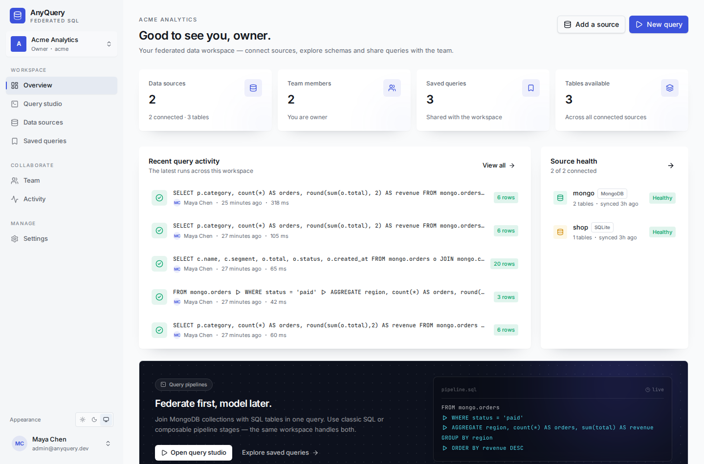
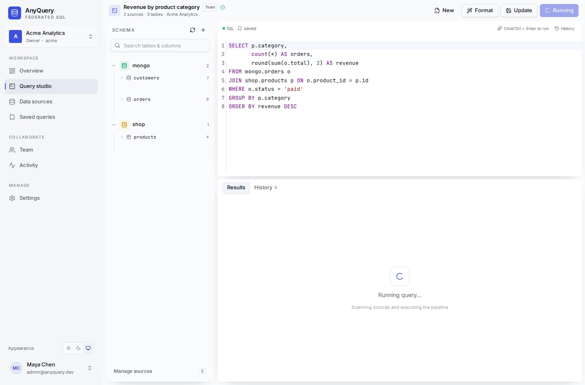
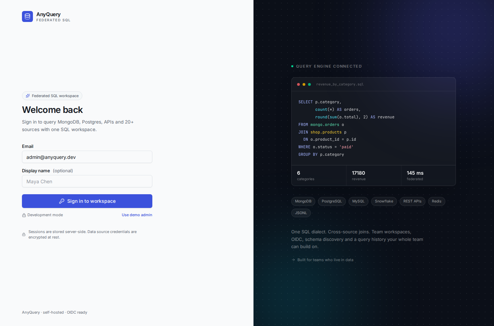
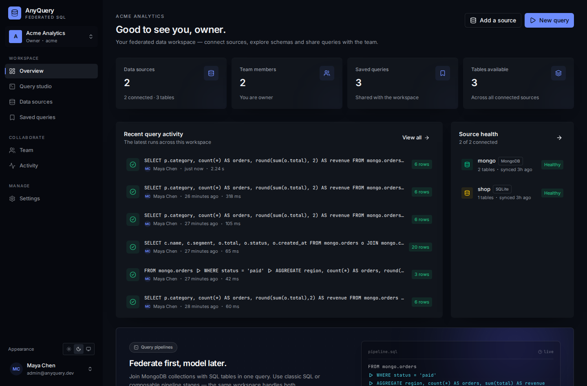
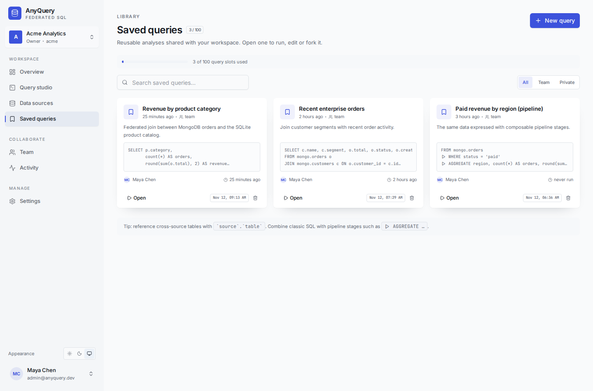
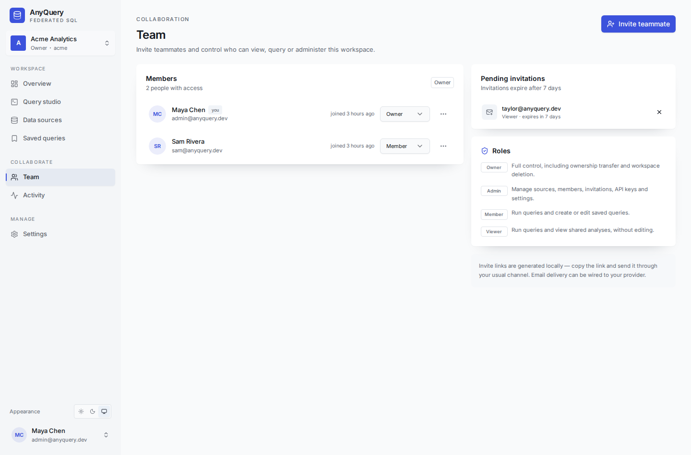

# AnyQuery

**一个自托管的联邦查询平台**：用一套 SQL（以及可组合的 Query Pipeline）把 MongoDB、Redis、PostgreSQL、MySQL、SQLite、Snowflake、Databricks、REST API、CSV、JSONL 等 20+ 数据源连在一起查询。面向团队：多租户工作区、成员角色、邀请、共享查询、审计日志、API Key 与 OIDC 登录。

- 后端：**Go**（标准库 `net/http` + 自研 SQL 解析器 / 执行引擎）
- 存储：**MongoDB**
- 前端：**React + Vite + shadcn/ui + Tailwind CSS v4**
- 包管理：**pnpm**
- 工具链：**mise**
- 认证：**OIDC**（Authorization Code + PKCE），开发模式提供本地登录

[](https://github.com/holihur/anyquery/actions/workflows/ci.yml)    


## 界面速览

| 工作台 | 查询工作室 |
| --- | --- |
|  |  |
| **登录 / OIDC** | **深色模式** |
|  |  |
| **共享查询库** | **团队与权限** |
|  |  |

> 截图来自本地演示工作区（MongoDB + SQLite 联邦查询）。

---

## 为什么是 AnyQuery

大多数团队的指标散落在 MongoDB、业务库、数据仓库、SaaS API 和文件里。AnyQuery 不要求先做 ETL：注册数据源、自动发现 schema，然后直接写跨源 JOIN。

```sql
SELECT p.category,
       count(*)                 AS orders,
       round(sum(o.total), 2)   AS revenue
FROM mongo.orders o
JOIN shop.products p ON o.product_id = p.id
WHERE o.status = 'paid'
GROUP BY p.category
ORDER BY revenue DESC
```

也可以使用可组合的 **Query Pipeline**：

```sql
FROM mongo.orders
|> WHERE status = 'paid'
|> AGGREGATE region, count(*) AS orders, sum(total) AS revenue GROUP BY region
|> ORDER BY revenue DESC
|> LIMIT 10
```

执行器内部同样是 operator pipeline：`scan → filter → aggregate → project → sort → limit`。管道语法只是同一执行计划的一种表达方式。

---

## 功能

- **联邦查询**：跨数据源 JOIN（inner / left / right / full / cross），CTE、FROM 子查询等常用查询能力。
- **自研 SQL 解析器**：没有依赖过时的第三方 MySQL parser；表达式、函数、语句和 pipe stage 都可以本地扩展。
- **23 种内置连接器**（见下表），连接器完全抽象，新增数据源只需实现接口并注册。
- **多租户**：`workspace` 隔离数据源、查询、成员、审计与 API Key；所有资源都带 `tenantId`。
- **团队协作**：owner / admin / member / viewer 角色，邮件邀请链接、共享/私有保存查询、最近 100 条查询历史、审计日志。
- **保存查询上限**：每个 workspace 最多 100 条保存查询，达到上限后 API 返回明确错误。
- **OIDC 登录**：任意标准 OIDC Provider（Auth0、Keycloak、Okta、Entra ID、Google 等）。
- **安全**：数据源凭据 AES-256-GCM 加密；会话 token 仅存 SHA-256；HttpOnly Cookie；Origin 校验；API Key 只显示一次。
- **团队 API**：工作区级 API Key 可直接调用执行接口。
- **查询护栏**：超时、单源行数上限、结果行数上限、JOIN 中间结果上限、截断警示。
- **Top 100**：查询历史展示最近 100 条；保存查询库每个工作区最多 100 条。
- **深色/浅色主题**、响应式布局、SQL 自动补全、schema 浏览器、结果排序/分页/CSV 导出。

---

## 快速开始

前置：MongoDB（本机或 Docker）、Go、Node、pnpm、mise。

```bash
# 1. 安装工具链与依赖
mise install
mise run setup

# 2. 启动 MongoDB（Docker）
mise run mongo

# 3. 写入演示数据 + 演示工作区
mise run seed

# 4. 两个终端分别启动
mise run dev:backend   # http://localhost:8080
mise run dev:web       # http://localhost:5173
```

打开 **http://localhost:5173**，使用开发登录：

```
admin@anyquery.dev
```

演示工作区 `acme` 自带：

- `mongo.customers` / `mongo.orders`（MongoDB）
- `shop.products`（SQLite）
- 3 个已保存查询（含跨源 JOIN 和 pipeline）
- 成员 `sam@anyquery.dev`，以及一个待接受的 viewer 邀请

### 一键 Docker

```bash
docker compose up --build
```

打开 **http://localhost:8080**，同样使用 `admin@anyquery.dev` 登录。容器会启动 MongoDB、构建前端并由 Go 服务托管 SPA，并自动执行一次 seed。

> 生产环境请设置 `AUTH_DEV_MODE=false`、`SEED_DEMO=false`、`APP_BASE_URL=https://your.domain` 和固定的 `DATA_ENCRYPTION_KEY`。

---

## 内置数据源（23）

> 每个连接器的详细验证进度、限制与 CI 状态见 **[docs/data-sources.md](docs/data-sources.md)**。CI 覆盖 MongoDB + SQLite、Redis、JSONL 与 PostgreSQL 的真实跨源 JOIN。

| 类别 | 数据源 | 连接方式 |
| --- | --- | --- |
| SQL | PostgreSQL、CockroachDB、Redshift、TimescaleDB、YugabyteDB | `pgx` |
| SQL | MySQL、MariaDB、SingleStore | `go-sql-driver/mysql` |
| SQL | Microsoft SQL Server | `go-mssqldb` |
| SQL | SQLite | `modernc.org/sqlite`（纯 Go） |
| SQL | ClickHouse | `clickhouse-go/v2` |
| SQL | Trino、Presto | `trino-go-client` |
| SQL | Oracle | `go-ora` |
| 云数仓 | Snowflake | 官方 SQL API（OAuth / PAT） |
| 云数仓 | Databricks SQL | 官方 Statement Execution API |
| NoSQL | MongoDB | 官方 Go driver |
| NoSQL | Redis | `go-redis/v9`，Hash/JSON 展开为列 |
| Search | Elasticsearch、OpenSearch | HTTP search API |
| API | REST / JSON | 通用 HTTP + JSON path |
| File | CSV / TSV URL | 通用 HTTP + `encoding/csv` |
| File | JSON Lines / NDJSON | 通用 HTTP + 逐行解析 |

Slack/Google Sheets 等系统可以通过 **REST** 连接器接入；只要 HTTP 能返回 JSON 数组，就能成为一张表。新增专用连接器见 [docs/connectors.md](docs/connectors.md)。

---

## 连接器抽象

Query engine 只认识抽象接口，不认识任何具体数据库：

```go
type Provider interface {
    Spec() TypeSpec
    Open(ctx context.Context, config map[string]string) (Connector, error)
}

type Connector interface {
    Ping(ctx context.Context) error
    Introspect(ctx context.Context) ([]Table, error)
    Fetch(ctx context.Context, req FetchRequest) (*FetchResult, error)
    Capabilities() Capabilities
    Close() error
}
```

- `TypeSpec` 声明连接参数（包含 `secret` 字段），前端据此自动渲染表单，后端据此做密钥脱敏。
- `Introspect` 返回表/列/schema；列类型会进入编辑器补全和结果表。
- `Fetch` 返回 JSON-friendly 行数据并必须尊重行数上限。
- SQL 家族复用 `sqlconn` 的通用实现：DSN、标识符引用、LIMIT 方言、information_schema 探测。
- 新连接器 = 实现接口 + `connector.Register` + 在 `internal/connectors/all` 中 blank import。

---

## 多租户与团队

```
User ──< Membership >── Workspace ──< DataSource
                           ├──< SavedQuery
                           ├──< QueryRun
                           ├──< Invite
                           ├──< APIKey
                           └──< AuditLog
```

| 角色 | 查询 | 保存/编辑查询 | 管理数据源 | 成员/邀请 | API Key |
| --- | --- | --- | --- | --- | --- |
| owner | ✅ | ✅ | ✅ | ✅ + 转让所有权 | ✅ |
| admin | ✅ | ✅ | ✅ | ✅ | ✅ |
| member | ✅ | ✅（自己的/团队） | ❌ | ❌ | ❌ |
| viewer | ✅ | ❌ | ❌ | ❌ | ❌ |

- 所有 API 路由都经过 workspace 成员校验；API Key 绑定单一 workspace。
- 邀请需要与登录邮箱一致，7 天过期，可撤销。
- 私有保存查询仅作者与管理员可见。
- 审计事件覆盖数据源、成员、邀请、保存查询与 API Key 的变更。

---

## OIDC 配置

```bash
OIDC_ISSUER=https://your-tenant.us.auth0.com/
OIDC_CLIENT_ID=...
OIDC_CLIENT_SECRET=...
OIDC_REDIRECT_URL=http://localhost:8080/api/v1/auth/oidc/callback
OIDC_SCOPES=openid,profile,email
AUTH_DEV_MODE=false
```

- 首次登录会按 `(issuer, subject)` 创建用户。
- 若邮箱已存在，只有在 `email_verified=true` 时才会绑定，避免账号劫持。
- 新用户没有工作区：可以创建自己的工作区，或通过邀请链接加入。
- 回调地址必须与 IdP 配置一致；`APP_BASE_URL` 用于生成邀请链接与回调跳转。

> 当前是全局 OIDC；按 workspace 配置独立 IdP 在 roadmap 中。

---

## 配置

| 环境变量 | 默认值 | 说明 |
| --- | --- | --- |
| `PORT` | `8080` | API 监听端口 |
| `APP_BASE_URL` | `http://localhost:8080` | 公开访问地址，用于 Cookie、邀请链接、OIDC 回调 |
| `WEB_DIR` | 自动探测 | 构建后的 SPA 目录，默认 `frontend/dist` / `../frontend/dist` |
| `MONGODB_URI` | `mongodb://localhost:27017` | MongoDB 连接串 |
| `MONGODB_DB` | `anyquery` | MongoDB 数据库 |
| `AUTH_DEV_MODE` | `true` | 本地邮箱登录；生产必须关闭 |
| `SESSION_TTL_HOURS` | `168` | 会话有效期 |
| `DATA_ENCRYPTION_KEY` | dev fallback | 32 字节 base64，生产必填：`openssl rand -base64 32` |
| `APP_ALLOWED_ORIGINS` | 同源 + dev localhost | 允许的跨域来源（逗号分隔） |
| `QUERY_TIMEOUT_SECONDS` | `30` | 单次查询超时 |
| `QUERY_MAX_SOURCE_ROWS` | `100000` | 每个源表最多拉取行数 |
| `QUERY_MAX_RESULT_ROWS` | `10000` | 返回给前端的结果行数上限 |
| `COOKIE_SECURE` | 由 https 推导 | 强制 Secure Cookie |
| `OIDC_*` | — | 见上节 |
| `SEED_DEMO` | `false` | 容器入口是否自动 seed |

---

## API 示例

执行查询（工作区 API Key）：

```bash
curl -X POST http://localhost:8080/api/v1/tenants/acme/queries/execute \
  -H "Authorization: Bearer aq_…" \
  -H "Content-Type: application/json" \
  -d '{"sql":"SELECT * FROM `mongo`.`orders` LIMIT 5"}'
```

主要路由：

```
GET    /api/v1/auth/config
GET    /api/v1/auth/oidc/login
GET    /api/v1/auth/oidc/callback
POST   /api/v1/auth/dev-login
GET    /api/v1/auth/me
POST   /api/v1/auth/logout

GET    /api/v1/datasource-types
GET    /api/v1/tenants/{tenant}/datasources
POST   /api/v1/tenants/{tenant}/datasources
PATCH  /api/v1/tenants/{tenant}/datasources/{id}
DELETE /api/v1/tenants/{tenant}/datasources/{id}
POST   /api/v1/tenants/{tenant}/datasources/{id}/test
POST   /api/v1/tenants/{tenant}/datasources/{id}/refresh
GET    /api/v1/tenants/{tenant}/catalog

POST   /api/v1/tenants/{tenant}/queries/execute
GET    /api/v1/tenants/{tenant}/queries
POST   /api/v1/tenants/{tenant}/queries
GET    /api/v1/tenants/{tenant}/runs
GET    /api/v1/tenants/{tenant}/audit

GET    /api/v1/tenants/{tenant}/members
POST   /api/v1/tenants/{tenant}/invites
POST   /api/v1/invites/accept
GET    /api/v1/tenants/{tenant}/apikeys
```

---

## SQL 支持

- `SELECT [DISTINCT]`、表达式、别名、`FROM`、`WHERE`、`GROUP BY`、`HAVING`、`ORDER BY`、`LIMIT/OFFSET`
- `INNER / LEFT / RIGHT / FULL / CROSS JOIN`、`ON` / `USING`
- 多表逗号连接、`WITH` CTE、FROM 子查询
- 聚合：`count / sum / avg / min / max / count(distinct) / group_concat / array_agg / bool_and / bool_or`
- 常用标量函数：`lower / upper / length / trim / substring / concat / coalesce / ifnull / nullif / abs / round / ceil / floor / power / sqrt / replace / split_part / date_trunc / now / md5 / sha256 / json_extract …`
- 运算符：算术、比较、`LIKE / ILIKE / REGEXP`、`IN`、`BETWEEN`、`IS NULL`、`CASE`、`CAST`、`::`
- Pipeline stages：`WHERE`、`SELECT`、`AGGREGATE … GROUP BY`、`ORDER BY`、`LIMIT`、`DISTINCT`、`JOIN`

查询中的表名格式为 `` `source`.`table` ``（schema 可包含在 table 内，例如 `` `pg`.`public.users` ``）。执行器对表名做 catalog 校验并逐方言安全引用。

**保存查询上限**：每个 workspace 100 条；超出时返回 `409 saved_query_limit`，UI 会提示删除旧查询。查询历史最多展示最近 100 条。

**安全护栏**：MVP 将源数据按上限拉入引擎后执行 JOIN/聚合，所有过滤在内存中完成；已实现 LIMIT 下推。谓词下推、列裁剪和更细粒度并行在 roadmap 中。

---

## 项目结构

```
.
├── backend
│   ├── cmd/server            # API server
│   ├── cmd/seed              # demo seeding
│   └── internal
│       ├── api               # HTTP routes, auth middleware, tenant checks
│       ├── auth              # OIDC + sessions
│       ├── config            # env config
│       ├── connector         # connector abstraction & registry
│       ├── sqlconn           # generic database/sql connectors
│       ├── mongodb           # MongoDB connector
│       ├── redisdb           # Redis keyspace connector
│       ├── httpjson          # REST & CSV connectors
│       ├── elasticsearch     # Elasticsearch / OpenSearch
│       ├── cloudsql          # Snowflake / Databricks HTTP APIs
│       ├── sql               # lexer, parser, AST, formatter
│       ├── engine            # binder, joins, aggregation, pipelines
│       ├── store             # MongoDB repositories & indexes
│       ├── cryptox           # AES-GCM & token hashing
│       └── demo              # demo workspace
├── frontend
│   └── src
│       ├── pages             # login, overview, query studio, sources, team…
│       ├── components/ui     # shadcn-style primitives
│       ├── components/query  # schema explorer, results table, save dialog
│       ├── providers         # auth, tenant, theme
│       └── lib               # API client, types, utils
├── docs/connectors.md
├── docs/data-sources.md     # connector support matrix
├── .github/workflows/ci.yml
├── mise.toml
├── docker-compose.yml
└── Dockerfile
```

---

## 开发命令

```bash
mise run setup      # 安装依赖
mise run mongo      # 启动 MongoDB
mise run seed       # 初始化演示数据
mise run dev:backend
mise run dev:web
mise run test       # Go tests + 前端生产构建
mise run build      # 编译后端二进制 + 构建 SPA
mise run vet        # go vet + TypeScript 构建
```

后端单元测试覆盖 SQL 解析、管道语法、跨源 JOIN、聚合、CTE、HAVING、NULL 语义等：

```bash
cd backend && go test ./...
```

---

## 安全说明

- 数据源凭据在 MongoDB 中加密存储；API 仅返回脱敏后的配置。更新时 `••••••••` 会保留旧密钥。
- 会话使用随机 token，仅存 SHA-256 哈希；Cookie 为 HttpOnly / SameSite=Lax，HTTPS 下自动 Secure。
- 浏览器发起的写请求会校验 `Origin`；`APP_ALLOWED_ORIGINS` 控制额外来源。
- 数据源和邀请只能由 admin/owner 操作；查询执行对所有成员开放（viewer 只读）。
- REST/CSV/Elasticsearch 连接器允许用户填写 URL。生产部署建议配合网络出口策略，限制可访问的内网地址（SSRF 防护）。
- 平台不执行源端 DDL；连接器应使用只读账号。
- 生产请关闭开发登录、使用强随机加密密钥、启用 HTTPS，并定期轮换 API Key。

---

## 已知边界 / Roadmap

- 当前 Query Pipeline 是查询管道；**定时 ETL pipeline**（查询 → 调度 → 写入目标）尚未实现，可复用现有执行计划扩展。
- 谓词/投影下推、源端聚合、并发扫描、流式结果。
- 每租户独立 OIDC / SCIM、审计导出、查询排队与并发配额。
- 邮件发送（邀请/告警）目前只生成链接。
- 更完整的 SQL：窗口函数、UNION/INTERSECT、参数化查询、物化视图。
- 更多连接器：BigQuery、Athena、DuckDB、Google Sheets、Kafka 等。

---

## License

MIT（示例）。发布前请根据组织要求调整。
